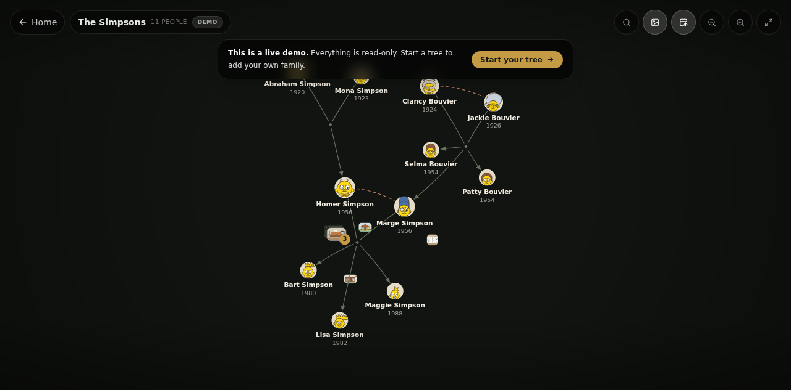

<p align="center">
  
</p>

<h1 align="center">family-tree.page</h1>

<p align="center">
  A private family tree that looks like a family, not a spreadsheet.
</p>

<p align="center">
  <a href="https://family-tree.page">Live app</a> ·
  <a href="https://family-tree.page/demo">Try the demo</a> ·
  <a href="docs/README.md">Documentation</a> ·
  <a href="LICENSE">MIT licensed</a>
</p>

<p align="center">
  <a href="https://family-tree.page/demo"></a>
</p>

<p align="center">
  <a href="https://github.com/metruzanca/family-tree.page/actions/workflows/ci.yml"></a>
  <a href="LICENSE"></a>
  <a href="package.json"></a>
</p>

## Why another family tree app?

Most genealogy tools put a form in front of you. Add a person, add another person, then fill in a table of relationships.

This one puts the family in front of you. People are nodes, relationships are lines, and photos hang off the person they belong to. You move through the tree the way you talk about it: "that's my grandmother's sister, her son is..."

It is free to use, open source, and self-hostable. Your tree is private by default, and you can take it with you.

## What you get

**A real graph.** A force-directed canvas with family junctions, arrows from parent to child, and link routing that stops one family's line from passing behind a stranger. Optional generation bands and birth-year gravity keep big trees readable. Focus rings let you open on your own branch and expand outward.

**Photos that stay attached.** Upload photos and documents to people, file them into folders, or drop them in the tree inbox until you know where they belong. Client-side thumbnails, EXIF dates, albums, tags, and face boxes detected in your browser. Face data never leaves the device.

**A research desk for the rest of us.** Family group sheets, an individual dossier, Ahnentafel pedigree, Register and NGSQ descendant registers, surname clusters, place indexes, and a queue of contradictions and gaps. All linkable and print-friendly.

**Sharing that respects living people.** Invite editors and viewers, create a read-only link, or publish a tree with living people reduced to names, hidden, or shown in full. Links can expire and can be revoked at any time.

**Collaboration without a spreadsheet.** See who else has the tree open and which person they are looking at. Activity history records field-level changes. Other open tabs refresh when someone edits.

**Calendars and reminders.** Birthdays and anniversaries in the app, an iCal feed for Google Calendar, Apple Calendar, or Outlook, and optional email reminders.

**No lock-in.** Export GEDCOM 5.5.1 or 7 for Ancestry, MyHeritage, Gramps, RootsMagic, and friends. Import a GEDCOM file with a preview and per-person create, merge, or skip. Read everything from a token-scoped JSON API. Download a zip of your account and every original, or delete it all.

## Quick start

You need Node 24 and pnpm. The repo ships a Nix shell with both, plus PostgreSQL and a local S3 stand-in, so Docker is not required.

```bash
git clone https://github.com/metruzanca/family-tree.page.git
cd family-tree.page

nix-shell           # optional: Node 24, pnpm, PostgreSQL
pnpm install
cp .env.example .env

pnpm dev:services   # local Postgres and S3
pnpm db:migrate
pnpm db:seed
pnpm dev
```

Open <http://localhost:3000> and sign in with:

```text
demo@family-tree.local
family-tree-demo-12345
```

No Nix? Use your own PostgreSQL and any S3-compatible storage, then point the `DATABASE_URL` and `S3_*` variables at them. The full setup, including production copies and dangerous-environment guards, is in [docs/development.md](docs/development.md).

## Self-hosting

The app is one service, one PostgreSQL database, and one private S3 bucket. Add a second bucket if you want the built-in nightly database and media backup.

Railway is the happy path and is what production uses, but nothing is Railway-specific: any Node host, Postgres, and S3-compatible storage will do. See [docs/operations.md](docs/operations.md) for environment variables, deployment, backups, logging, analytics, and quotas.

## Stack

- [SolidStart](https://start.solidjs.com) 2 and SolidJS
- [Drizzle ORM](https://orm.drizzle.team) with PostgreSQL
- S3-compatible storage for originals and thumbnails
- [`force-graph`](https://github.com/vasturiano/force-graph) with a custom link pass, plus `d3-force`
- [Tailwind CSS](https://tailwindcss.com) v4 and [shadcn-solid](https://shadcn-solid.com) on Kobalte
- Zod for server input validation, Vitest for unit tests

## Documentation

| Document | What is in it |
|---|---|
| [Features](docs/features.md) | Everything the app does, plus known limitations |
| [Architecture](docs/architecture.md) | Graph rendering, live refresh, presence, calendar feeds |
| [Development](docs/development.md) | Local setup, scripts, project layout, UI conventions |
| [Translations](docs/i18n.md) | English and Italian dictionaries, locale detection, adding a language |
| [Operations](docs/operations.md) | Environment variables, deployment, backups, privacy |
| [API](docs/api.md) | The read-only `/api/v1` and its OpenAPI contract |
| [GEDCOM](docs/gedcom.md) | Export and import details |
| [Research guide](docs/research.md) | The full guide for genealogists |
| [Roadmap](docs/roadmap.md) | What comes after v0.1.0 |

## Status

v0.1.0. It runs a real family tree in production, but it is still early. There is no realtime co-editing or person merge tool yet. The [known limitations](docs/features.md#known-limitations) are listed in full rather than buried.

## Contributing

Issues and pull requests are welcome. Good places to help:

- Translations. English and Italian ship today; [docs/i18n.md](docs/i18n.md) explains the string files.
- Accessibility, keyboard, and mobile polish.
- Tests around the graph layout, fuzzy dates, and GEDCOM round trips.
- The research views and the import preview.

Before opening a PR, run `pnpm typecheck` and `pnpm test`, and read [docs/development.md](docs/development.md) for conventions. Commits follow the conventional format (`feat:`, `fix:`, `chore:`).

## License

[MIT](LICENSE).
